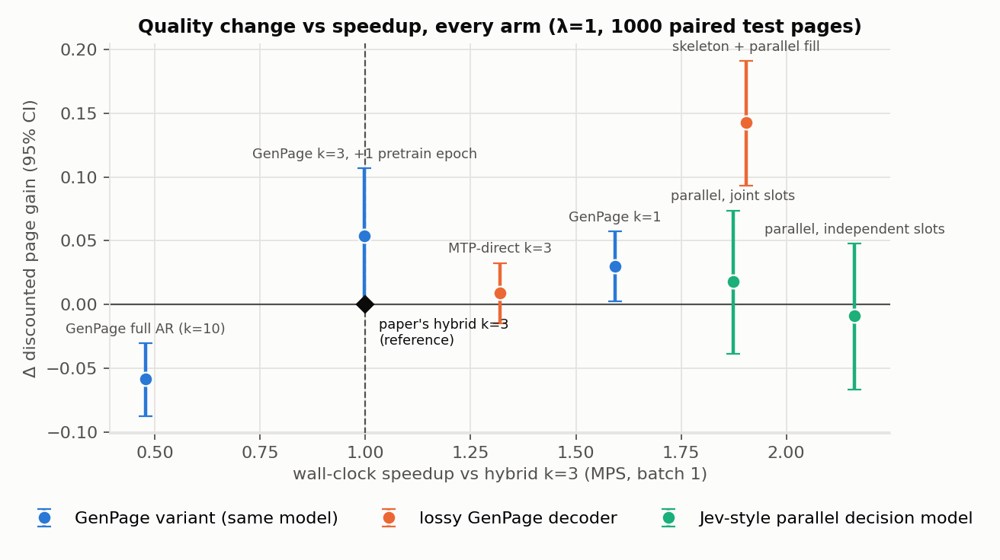
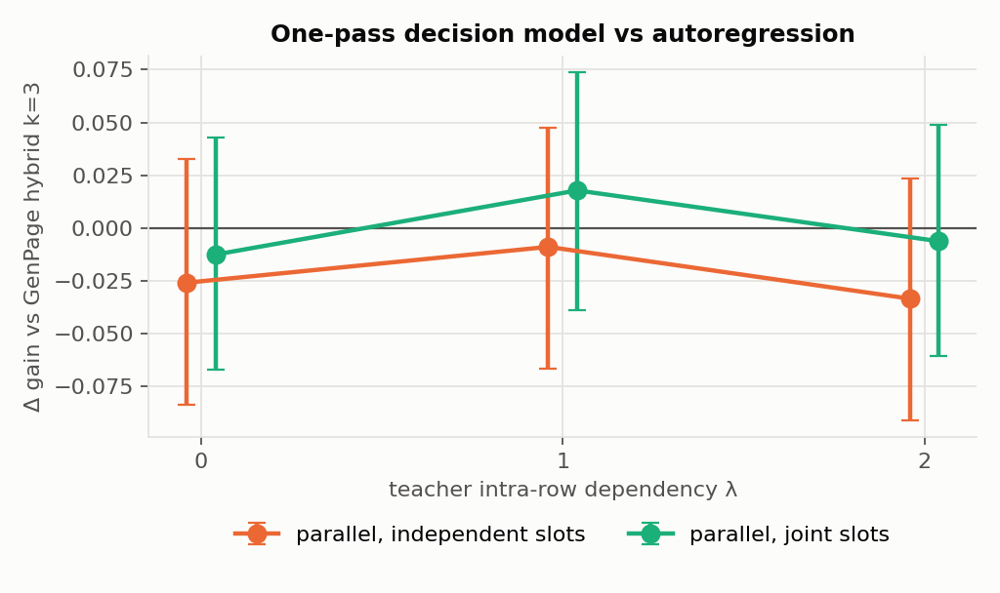
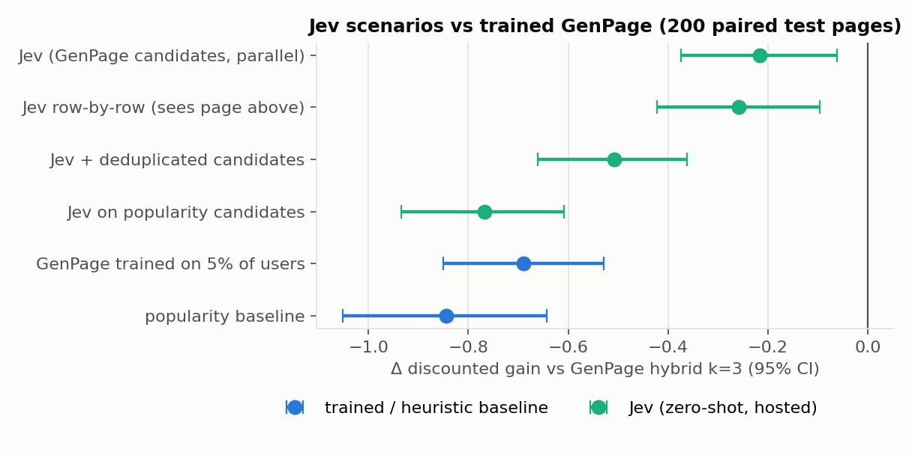

# mini-GenPage — results

Reproduction of the serving side of GenPage (Wang, Pan, Baltrunas, RecSys '26) on MovieLens-1M, Apple M3,
batch-1 serving. All numbers: held-out test users. Full tables: `report_tables.md`; plots: `../plots/`.

> All experiments final. Quality claims below use **paired bootstrap 95% CIs on 1000 test pages** (200 for the
> Jev runs); single-run tables further down are kept for detail.

## TL;DR

1. **The paper's recipe reproduces in miniature.** WBC post-training beats the "production" teacher it learned from
   by **17–20% discounted gain at every λ** (all significant). Imitation pretraining alone sits below the teacher;
   skipping pretraining costs 4.4 entity-AUC points (paper: 1.0).
2. **Self-speculative decoding is exactly lossless** (100% identical pages, 30 configurations, MPS and CPU) and cuts
   forwards 1.2–1.6×, but **wall-clock speedup is ~1.0×** at this scale. Verify overhead (~11 ms/page in this
   implementation) cancels the savings, and acceptance collapses after the 2nd draft position (~50% → ~20%).
3. **Within-row autoregression doesn't pay here.** Fewer AR steps are never significantly worse:
   k=1 vs k=3 is +1.3% (sig) / +0.9% / −0.5% at λ=1/0/2, at **1.6× lower latency**. Full AR (k=10) is significantly
   **worse at every λ (−2.0 to −2.5%)**. MTP-direct (unverified drafts) ties k=3 at 1.32× speed.
   Exact-match verification protects choices among near-tied titles that don't move engagement.
4. **Skeleton + parallel fill is the best arm: +3.8% [+1.6%, +5.9%] over an equal-training-budget GenPage, at 1.9× speed.**
   (+6.2% vs the standard GenPage, of which ~2.3 points is the extra pretraining epoch.) Choosing all rows first and
   filling them together beats generating rows one after another.
5. **A one-pass, Jev-style decision model ties GenPage at 2× speed (4.4× on CPU).** Every λ is within ±1.4% and n.s.
   It works as *score once + greedy constraint-aware assignment*, i.e. a pointwise ranker with a smart decoder.
   (On 300 pages its gap looked like it grew with λ; at 1000 pages that trend is gone, so it was noise.)
6. **The real Jev (zero-shot, hosted) does not beat a trained recommender:** −9.9% gain (sig), recall tied, 2.6× slower.
   Neither fix helped: deduplicating its candidates made it **worse** (−15% vs plain Jev), and row-by-row calls tied the one-call
   version at 4× latency. **Cold start is where it pays:** re-ranking popularity candidates with no learned model,
   Jev beats popularity on recall (+12%, sig) and **ties a GenPage trained on 5% of users**.
7. **Where time goes:** decode forwards dominate short prompts. Masks + selection cost a fixed ~15 ms/page on MPS
   (~18%). Prefill rises to 26% (S) / 41% (M) of latency at 500 history actions on MPS and 51–57% on CPU, so richer
   prompts move the bottleneck to prefill.

## Setup (what maps to the paper)

* **Tokens:** one per row, one per title; context = profile, request time, and the last 100 rated titles as
  (title, rating bucket, Δt bucket).
* **Pages:** 6 rows × 10 titles; 26 row types; business rules enforced by per-step masks
  (Top Picks pinned, no repeats, row eligibility, no watched titles). **Zero violations in every arm of every experiment.**
* **"Production" logs:** a synthetic teacher (SVD fold-in + MMR). Its intra-row dependency **λ ∈ {0, 1, 2}** is the
  controlled variable, and teacher quality is flat across λ (≈4.2 hits/page). Feedback = the user's next 30 ratings.
* **Models:** S (3.2M non-embedding params) and M (8×). Pretrain = NTP on positively engaged pages; WBC = sign/magnitude
  weighted BCE with random negatives; untied embeddings. Every alternative arm starts from the same pretrain
  checkpoint and gets 2 WBC epochs, matching GenPage.

## E1 — baseline (λ=1, 500 test pages)

| arm | disc. gain | recall@page | diversity | MPS latency |
|---|---|---|---|---|
| teacher (logged) | 1.971 | 0.266 | 0.719 | – |
| pretrain only | 1.683 | 0.231 | 0.714 | 84 ms |
| **WBC (S)** | **2.326** | **0.310** | 0.680 | 84 ms |
| WBC, no pretraining | 1.716 | 0.237 | 0.657 | 84 ms |
| WBC (M, 8× params) | 2.292 | 0.302 | 0.681 | 170 ms |

Table-1 analogue (test): WBC loss 0.108 vs 0.127; row AUC 0.744 vs 0.728; entity AUC **0.730 vs 0.686**.
At this data size M is no better than S, consistent in spirit with the paper's "context beats capacity".
WBC trades diversity for relevance (0.72 → 0.68), the flip side of the paper's RL-raises-diversity result.

## E2 — latency breakdown (batch 1, hybrid k=3)

| | 50 actions | 100 | 200 | 500 |
|---|---|---|---|---|
| MPS, S | 81 ms (prefill 4%) | 86 (5%) | 93 (10%) | 127 (26%) |
| MPS, M | 162 (6%) | 177 (10%) | 212 (18%) | 383 (41%) |
| CPU, S | 26 (14%) | 30 (20%) | 35 (29%) | 74 (51%) |
| CPU, M | 128 (15%) | 145 (24%) | 184 (36%) | 337 (57%) |

On MPS, masks + selection cost a constant ~15 ms/page: small kernels and host syncs, not FLOPs. That echoes the
paper's note that dynamic per-request masks needed inference-engine customization.

## E3 — self-speculative decoding (300 pages per config)

| WBC S | acceptance (k=3) | acc. at draft pos 2 / 3 / 4 | forwards k=3 / k=10 | MPS speedup k=3 / k=10 |
|---|---|---|---|---|
| λ=0 | 0.39 | 0.53 / 0.18 / – (k=5: 0.07) | 30→24.1 / 67→42.6 | 1.02 / 0.91 |
| λ=1 | 0.42 | 0.54 / 0.23 | 30→23.9 / 67→42.4 | 1.02 / 0.95 |
| λ=2 | 0.33 | 0.43 / 0.18 | 30→24.8 / 67→43.8 | 0.93 / 0.92 |

* **Exact pages: 100%** everywhere (incl. batched-vs-single-token numerics on MPS).
* The imitation (pretrain-only) model's acceptance falls cleanly with λ: **0.40 → 0.29 → 0.20**. It inherits
  the teacher's intra-row dependency. The WBC model's values only partly do.
* Speedup ≈1.0× on S. On CPU the M model gets *slower* (0.63–0.84×), because verifying wide drafts is real compute.
  The E2 profile shows a ~11 ms/page verify cost on MPS (mask construction + host syncs). A verifier that works on the
  CPU-side top-k lists should recover ~10%, so this part is implementation, not inherent.

## E4 — MTP heads (λ=1)

| k=3 | forwards | MPS latency | gain | slot agreement with AR |
|---|---|---|---|---|
| hybrid AR | 30 | 92.5 ms | 2.394 | – |
| self-spec (lossless) | 23.9 | 87.4 ms | 2.394 | 100% |
| MTP-spec (lossless) | 22.8 | 88.7 ms | 2.394 | 100% (acceptance 0.51 vs 0.42) |
| **MTP-direct (lossy)** | **18** | **63.6 ms** | **2.412** | 30% |

## E5 — skeleton + parallel fill (λ=1)

| | forwards | MPS / CPU latency | gain | diversity |
|---|---|---|---|---|
| hybrid k=3 | 30 | 84 / 28 ms | 2.394 | 0.675 |
| skeleton k=3 | 11 | **44 / 15 ms** | **2.515** | 0.694 |

1.9× faster with higher measured gain. The skeleton model saw one extra (layout) pretraining epoch, so it is compared
below against a GenPage given the same extra epoch: **+3.8% [+1.6%, +5.9%], still significant.**

## E6 — confidence-gated hybrid ("decision model as a component")

A logistic gate on ranking features is well calibrated (ECE ≤ 0.005) for "would stopping now reproduce the full-k row
exactly?". But that event has a **1.6% base rate**, so the gate never fires and even an oracle saves only 0.5
forwards/page. The fixed-k sweep shows why exactness is the wrong target:

| gain | k=1 (18 fwd) | k=2 | k=3 | k=4 | k=5 (42 fwd) |
|---|---|---|---|---|---|
| λ=0 | 2.344 | 2.369 | 2.356 | 2.341 | 2.364 |
| λ=1 | 2.414 | 2.413 | 2.393 | 2.380 | 2.357 |
| λ=2 | 2.392 | 2.391 | 2.408 | 2.367 | 2.350 |

A gate should predict *quality loss from stopping*, not *output change*. On this data that loss is ≈0 at k=1.

## E7 — Jev-style one-pass decision model (300 pages)

| gain / MPS latency | hybrid k=3 | full AR k=10 | parallel, independent slots | parallel, joint slots |
|---|---|---|---|---|
| λ=0 | 2.356 / 90 ms | 2.298 / 176 | **2.383 / 44** | 2.373 / 41 |
| λ=1 | 2.394 / 83 | 2.337 / 177 | 2.376 / 43 | 2.388 / 38 |
| λ=2 | 2.408 / 83 | 2.325 / 177 | 2.330 / 41 | 2.436 / 31 |

CPU latency: hybrid ~27 ms vs parallel ~6.3 ms. (These are 300-page runs; the apparent λ trend for independent slots
does not survive the 1000-page paired test below: all differences are n.s.) The parallel model predicts nearly the same ranking for every slot
of a row (~50 of 60 slot top-1s collide), so it works as **score once + greedy constrained assignment**, i.e. a
pointwise ranker with a constraint-aware decoder. Its value logits are also better calibrated (ECE 0.28 vs 0.38).

## E8 — the real Jev (TypeSafe System One, jev-1.13.0), λ=1, 200 pages

GenPage chooses the rows and proposes each row's top-50 eligible titles. Jev ranks each row's options in one call
per page (state = the user's last 30 rated titles as text). Same local constraint pass for both arms.

| | gain | recall | diversity | latency |
|---|---|---|---|---|
| GenPage hybrid k=3 | **2.193** | 0.293 | 0.678 | 89 ms |
| Jev | 1.976 (−9.9%, CI [−0.375, −0.062]) | 0.286 (n.s.) | 0.680 (n.s.) | 233 ms (network) |

34 of Jev's 60 top picks per page had to be replaced because a higher row had already used them. Its option
probabilities show ECE 0.07, but they are "which of these 50" shares, not hit probabilities, so that number is
not comparable to GenPage's calibration.

## Caveats

* Synthetic teacher; small models (3M/25M non-embedding vs 200M); one dataset; batch-1 serving on a laptop.
* Latency is my PyTorch implementation, not vLLM with custom kernels. Forward counts are the portable metric.
* Single-run quality deltas of a few percent need the paired CIs below.

## Paired significance vs GenPage hybrid k=3 (1000 test pages, 95% bootstrap CI)

**λ=0** (n=1000)

| arm | Δ gain | 95% CI | relative | significant | speedup (MPS) | forwards |
|---|---|---|---|---|---|---|
| teacher (logged) | -0.4294 | [-0.5178, -0.3408] | -18.3% | yes | – | – |
| GenPage k=1 | +0.0214 | [-0.0048, +0.0483] | +0.9% | no | 1.64 | 18.0 |
| GenPage full AR (k=10) | -0.0506 | [-0.0818, -0.0196] | -2.2% | yes | 0.49 | 67.0 |
| parallel, independent slots | -0.0259 | [-0.0834, +0.0325] | -1.1% | no | 2.05 | 1.0 |
| parallel, joint slots | -0.0126 | [-0.0671, +0.0431] | -0.5% | no | 2.26 | 1.0 |

**λ=1** (n=1000)

| arm | Δ gain | 95% CI | relative | significant | speedup (MPS) | forwards |
|---|---|---|---|---|---|---|
| teacher (logged) | -0.3880 | [-0.4783, -0.2982] | -16.8% | yes | – | – |
| GenPage k=1 | +0.0297 | [+0.0024, +0.0574] | +1.3% | yes | 1.59 | 18.0 |
| GenPage full AR (k=10) | -0.0586 | [-0.0873, -0.0304] | -2.5% | yes | 0.48 | 67.0 |
| MTP-direct k=3 | +0.0088 | [-0.0147, +0.0325] | +0.4% | no | 1.32 | 18.0 |
| skeleton + parallel fill | +0.1425 | [+0.0930, +0.1910] | +6.2% | yes | 1.90 | 11.0 |
| GenPage k=3, +1 pretrain epoch | +0.0537 | [+0.0008, +0.1068] | +2.3% | yes | 1.00 | 30.0 |
| parallel, independent slots | -0.0089 | [-0.0666, +0.0477] | -0.4% | no | 2.16 | 1.0 |
| parallel, joint slots | +0.0178 | [-0.0387, +0.0736] | +0.8% | no | 1.87 | 1.0 |

**λ=2** (n=1000)

| arm | Δ gain | 95% CI | relative | significant | speedup (MPS) | forwards |
|---|---|---|---|---|---|---|
| teacher (logged) | -0.4662 | [-0.5543, -0.3792] | -19.8% | yes | – | – |
| GenPage k=1 | -0.0128 | [-0.0410, +0.0162] | -0.5% | no | 1.59 | 18.0 |
| GenPage full AR (k=10) | -0.0471 | [-0.0753, -0.0197] | -2.0% | yes | 0.47 | 67.0 |
| parallel, independent slots | -0.0334 | [-0.0909, +0.0233] | -1.4% | no | 2.08 | 1.0 |
| parallel, joint slots | -0.0062 | [-0.0605, +0.0491] | -0.3% | no | 1.98 | 1.0 |

**Skeleton vs equal-budget control** (GenPage with the same 3 pretraining epochs, 1000 pages): Δ gain
**+0.0889 [+0.0384, +0.1394] (+3.8%)**, speedup 1.89×.

## E8b — Jev scenarios (same 200 pages as E8, paired)

| arm | gain | recall | live latency | calls/page |
|---|---|---|---|---|
| GenPage hybrid k=3 (full data) | **2.193** | **0.293** | 84 ms | – |
| Jev, GenPage candidates, one parallel call (E8) | 1.976 | 0.286 | 233 ms | 1 |
| Jev, round-robin deduplicated candidates | 1.685 | 0.254 | 232 ms | 1 |
| Jev, row by row, sees titles already placed | 1.935 | 0.277 | 929 ms | 6 |
| *cold start:* popularity baseline (no learning) | 1.348 | 0.204 | 12 ms | – |
| *cold start:* GenPage trained on 5% of users | 1.504 | 0.209 | 82 ms | – |
| *cold start:* Jev ranking popularity candidates | 1.425 | 0.228 | 181 ms | 1 |

Paired comparisons (95% CI):

* Jev vs GenPage: gain −0.217 [−0.375, −0.062] (sig); recall −0.007 (n.s.).
* Dedup vs plain Jev: **worse**. Round-robin pools strip rows of their best options; collisions were not the problem.
* Row-by-row vs plain Jev: no gain (−0.04) at 4× latency. Conditioning on earlier rows didn't help Jev either.
* Cold start: Jev-on-popularity vs popularity: gain +0.077 [−0.067, +0.218] (n.s.), **recall +0.024 (sig, +12%)**;
  vs GenPage-5%: gain −0.079 (n.s.), recall +0.019 (n.s.), i.e. **tied with a model trained on ~1,900 logged pages.**
* GenPage-5% vs popularity: gain +0.156 (sig).

Cost: ~9.5M input / 2.4M output tokens over 1,800 calls (cached in `results/jev_cache/`).

## What I'd say to the GenPage authors

1. In my reproduction, **exact-match speculative acceptance is a misleading signal**: drafts are rejected over
   near-tied titles while page quality is unchanged, and fewer within-row AR steps (k=1) were never worse.
   **Does conditioning on the first few entities matter at Netflix scale**, with real stopping-power effects
   my synthetic teacher can't model?
2. **Skeleton-first decoding** (all row tokens, then rows filled in parallel) beat layout-order decoding here by +3.8%
   at 1.9× speed, even against an equal training budget. That's cheap to try on a pretrained checkpoint.
3. A one-pass slot scorer with constraint-aware assignment matched hybrid decoding at 2× speed, which may matter as a
   latency fallback or for capacity headroom.

